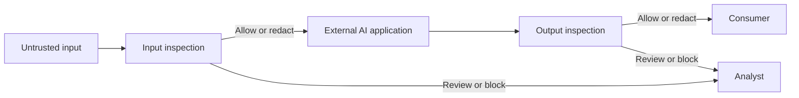

# PromptShield

An explainable, local-first security inspection layer for AI applications. Designed as a cybersecurity engineering portfolio project for enterprise AI risk and security operations.

## Quick start

Requires Node.js 20+; no dependencies, accounts, paid APIs or model downloads.

```sh
npm start
# Open http://127.0.0.1:3000
npm test
npm run benchmark
```

The browser workbench performs inspection entirely in memory and sends no prompt text to a server. The optional local HTTP API accepts JSON and is bound to loopback. Do not expose it to the internet; production authentication, authorisation, rate limits and transport security are outside this prototype.

## Capabilities

- Direct prompt injection, privileged role impersonation, policy bypass, prompt extraction and selected malicious instruction patterns.
- Indirect injection in retrieved documents and tool responses; caller supplies provenance.
- Email, synthetic insurance policy identifiers, selected API tokens, private keys, credential assignments, JWT-like tokens, Luhn-valid card and South African ID candidates.
- Unicode normalisation and selected invisible character removal.
- Output leakage detection using caller-provided protected markers.
- Four policy outcomes: allow, redact, review, block. Block and review return no forwardable text.
- Explainable rule IDs, severity, redaction counts and a bounded heuristic risk score.
- Synthetic evaluation suite with deliberately included misses and false positives.

## Architecture



This repository implements the inspection stages only. It does not call an AI model or execute remediation. Integrators must enforce decisions on the trusted server side and only forward sanitisedText for allow/redact. User-supplied direction, source or protected markers are not trusted policy inputs in a production integration.

## Local API

```sh
curl -s http://127.0.0.1:3000/api/inspect \
  -H 'Content-Type: application/json' \
  -d '{"text":"Contact demo@example.com","options":{"direction":"input","source":"user"}}'
```

Returns a JSON object with decision, riskScore, findings, redactionCount and sanitisedText. Text is capped at 20,000 UTF-16 code units. Input normalisation changes forwarded text. The risk score adds 45 per high-severity finding and 20 per medium finding, capped at 100; it is not a probability.

## Evaluation

The benchmark is a hand-authored synthetic challenge set, not an independent or representative dataset. It includes educational quotation false positives, semantic paraphrases, non-English attacks and unlabelled private information. Run the evaluation tab or npm run benchmark to see actual results, including mismatches. The regression tests cover expected supported behaviours rather than requiring the challenge cases to pass.

## Security and privacy

Read [the threat model](docs/threat-model.md) and [security policy](SECURITY.md). No real customer data, secrets or production integrations should be used with the demo. The rules are deliberately conservative; they cannot establish semantic intent or guarantee detection. This is a deterministic rule engine, not a trained ML classifier.

## Next steps

Independent labelled evaluation, multilingual coverage, policy versioning, context-aware detection, model-assisted classification evaluated against the deterministic baseline, and an authenticated production gateway.
