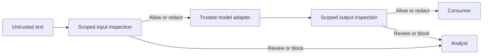

# PromptShield

A deterministic, explainable security inspection service and browser workbench for AI applications. Detects configured prompt-injection patterns, malicious instructions and sensitive data exposure. Intended for enterprise integration evaluation, not as a standalone guarantee of AI safety.

## Quick start

Requires Node.js 22+. No runtime dependencies or external model APIs.

```sh
npm start
# Open http://127.0.0.1:3000
npm test
npm run benchmark
```

The workbench runs entirely in the browser, with no prompt uploads, persistent storage or telemetry. It uses the standard demonstration policy. The server API is disabled until service credentials are configured, and defaults to strict policy.

## Service integration

Generate a high-entropy credential and its SHA-256 configuration:

```sh
node scripts/create-client.mjs claims-service
```

Store the token in your client's secret manager. Inject the printed PS_CLIENTS_JSON configuration into the server environment. Restart the service. Configure protected canaries through PS_PROTECTED_MARKERS_JSON. Assign only the necessary input/output scopes to each service. Never expose these credentials to browsers or untrusted callers.

```sh
curl -s http://127.0.0.1:3000/v1/inspect/input \
  -H "Authorization: Bearer ${PS_TOKEN}" \
  -H 'Content-Type: application/json' \
  -d '{"text":"Summarise this public report.","source":"user"}'
```

The output inspection endpoint is POST /v1/inspect/output. Both accept text and optional source (user, retrieved, tool). Direction, policy and protected markers are controlled by the endpoint and server configuration, not by the payload. Only the trusted integrating application can determine provenance. On a non-200 response, timeout or invalid response, withhold the original content. Only allow/redact with a non-null sanitisedText permits forwarding. Do not interpret HTTP 200 as permission by itself.

For a text-only Node integration, src/gateway.mjs provides createGuardedModel with a trusted provider callback. It inspects inputs and outputs and never calls the provider for a blocked/reviewed input. The provider adapter is responsible for deadlines, cancellation, tool permissions and model-specific structured output validation. This project does not execute tools or call an external model itself.

## Policy

| Policy | Input | Output |
| --- | --- | --- |
| standard | High injection or protected marker blocks; suspicious instruction reviews; recognised DLP redacts | High DLP or protected marker blocks; medium DLP redacts |
| strict (API default) | Same injection checks, all recognised DLP blocks | All recognised DLP blocks |

Risk scores are deterministic rule weights, not calibrated probabilities. Unicode normalisation may change forwarded content. The detector includes selected English and Afrikaans injection patterns, credential assignments, tokens, private keys, JWTs, emails, payment card and South African ID candidates, phone numbers and synthetic policy identifiers. It cannot establish semantic intent, classify all PII or reliably recognise every language or encoding.

## Architecture



## Operational controls

- SHA-256 high-entropy bearer credential digests, separate scopes, server-owned policies and protected markers.
- Explicit host allowlist, no browser API access or CORS, security headers and no-store responses.
- Request size, text length, concurrency, connection and per-credential rate limits. Fixed-window limits are per process, not distributed.
- Metadata-only audit events (request ID, service ID, decision, rule IDs, status and duration). No raw prompt, token or sanitised output logging.
- Non-root container image, health endpoint and graceful shutdown. TLS must terminate at a trusted reverse proxy; the container must not be publicly exposed.

See [deployment and release gates](docs/deployment.md), [threat model](docs/threat-model.md) and [security policy](SECURITY.md).

## Evaluation and limitations

Run npm test for regression and HTTP integration tests. Run npm run benchmark for a hand-authored synthetic challenge set, including expected misses and false positives. These are not independently sampled results. No trained classifier is included. External validation, representative multilingual data, independent adversarial assessment, sustained load testing and operational approval are required before using this service with real customer data.

Relevant scope: OWASP LLM application risks for prompt injection and sensitive information disclosure. This project does not claim OWASP certification, POPIA compliance or complete risk coverage.
